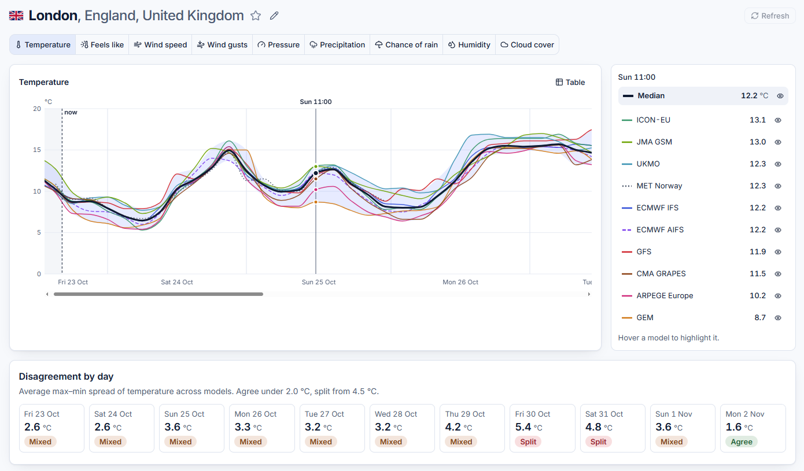
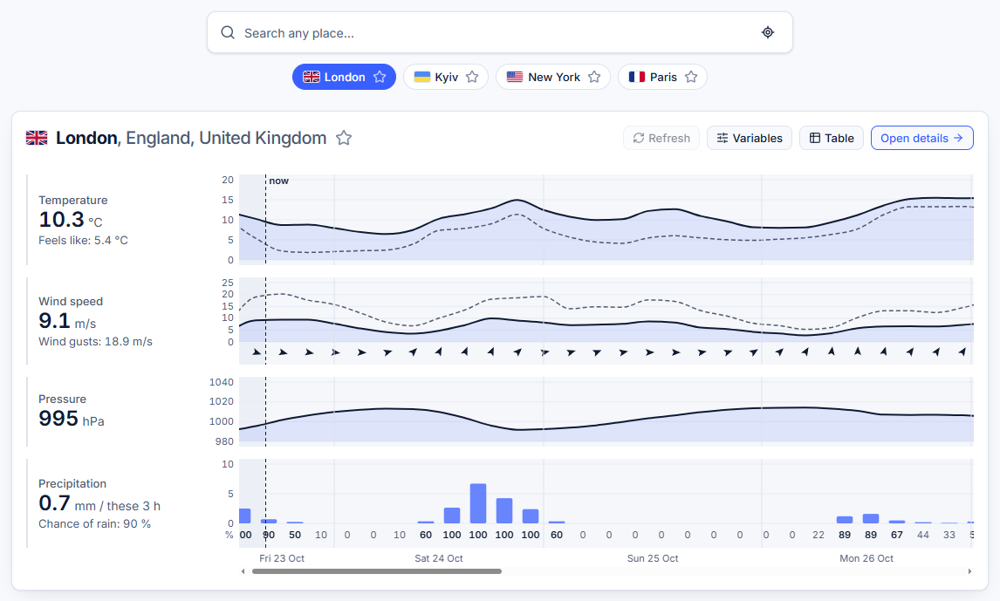

# Likely Weather

Compare what ten weather models forecast for any city, and see where they disagree. Viewers can hide or highlight any
model, switch between eight variables, turn any chart into a table, and look up a city's past weather back to 1940. An
Android app with a home-screen widget shows the same.

**[Try it live](https://likelyweather.com)** (no sign-up) · **[Download the Android app](https://likelyweather.com/app/likely-weather.apk)**
(APK, version 0.1.0; [all releases](https://github.com/haggifer/likelyweather/releases))

The APK installs outside the Play Store: Android asks to allow "Install unknown apps" for the browser, and Play Protect
may warn about an unknown developer. Each version's SHA-256 checksum sits beside it (`likely-weather-<version>.apk.sha256`
under `https://likelyweather.com/app/`), and later versions install over it as updates.

[](https://github.com/haggifer/likelyweather/actions/workflows/ci.yml)
[](LICENSE)





A pnpm and Turborepo monorepo: a Next.js web app, an Expo (React Native) Android app and an Express REST API on
Postgres (Prisma) and Redis, deployed to AWS Lambda and CloudFront with CDK. Live data comes from Open-Meteo and MET
Norway.

## Getting started

Needs Node 22, pnpm and Docker.

```bash
pnpm install
cp .env.example .env      # then put a real contact in METNO_USER_AGENT
pnpm db:up                # Postgres 16 and Redis 7 in Docker
pnpm db:deploy            # apply the Prisma migrations
pnpm db:seed              # the eleven seed cities
pnpm api                  # Docker services, then the API on http://localhost:4000
pnpm web                  # in a second terminal: the web app on http://localhost:3000
```

Open any city and its forecast is fetched within a few seconds; search for any other city to open it the same way. The
web app forwards `/api/*` to the API, so the browser sees one origin.

| Command                                                        | What it does                                                                                    |
| -------------------------------------------------------------- | ----------------------------------------------------------------------------------------------- |
| `pnpm api` / `web` / `mobile`                                  | One terminal each: Docker services then the API (`tsx watch`); the web app (Turbopack); Metro   |
| `pnpm db:up` / `db:deploy` / `db:migrate` / `db:seed`          | Docker services; apply migrations; create a new migration; seed the cities                      |
| `pnpm build`                                                   | Next.js build, the API's Lambda bundle (esbuild), Prisma client                                 |
| `pnpm test`                                                    | Vitest in every package but `apps/mobile` (Jest); database tests run when `DATABASE_URL` is set |
| `pnpm lint` / `typecheck` / `format` / `format:check`          | ESLint, TypeScript, Prettier with organize-imports                                              |
| `pnpm check:messages`                                          | Key and ICU argument parity across the six catalogs, and literal key usage in code              |
| `pnpm knip`                                                    | Unused files, exports and dependencies across the workspace (`knip.jsonc`)                      |
| `pnpm e2e`                                                     | Playwright flows on desktop and phone against a fake upstream (run `pnpm build` first)          |
| `pnpm cdk:synth` / `cdk:diff` / `cdk:deploy` / `cdk:bootstrap` | The AWS CDK stack in `infra/` (run `pnpm build` first; see [Deployment](#deployment))           |
| `pnpm --filter @fa/web flags`                                  | Re-copy the SVG country flags into `apps/web/public/flags`                                      |
| `pnpm --filter @fa/e2e parity --screen <screen>`               | Compare a screen's texts in the web's phone layout and the running Android app (`--help`)       |

### Mobile app

The app needs a development build, not Expo Go, and an Android device or emulator. Builds need a JDK 17 or 21 (on
`PATH` or in `JAVA_HOME`, not Android Studio's bundled 25) and CMake 4.1.2 from Android Studio's SDK Manager, which
`app.json` pins because the SDK's default CMake ships a ninja that can't handle a pnpm workspace's long paths on
Windows. Development builds call the live API unless `apps/mobile/.env.local` sets `EXPO_PUBLIC_API_ORIGIN`
(`apps/mobile/.env.example`; for the local API also run `adb reverse tcp:4000 tcp:4000`).

```bash
pnpm --filter @fa/mobile android   # build, install and start the development build
pnpm mobile                        # Metro for an installed development build
pnpm --filter @fa/mobile tokens    # regenerate src/theme/tokens.ts and src/global.css after editing apps/web/src/app/globals.css
pnpm --filter @fa/mobile icons     # regenerate the app icons and splash from the web's cloud-sun logo, and the widget picker's preview
```

A release APK (`npx expo prebuild --platform android`, then `gradlew app:assembleRelease` in `apps/mobile/android`) is
signed with the template's debug key unless the machine's Gradle properties (`~/.gradle/gradle.properties`) name the
release keystore: `LIKELYWEATHER_RELEASE_STORE_FILE`, `LIKELYWEATHER_RELEASE_STORE_PASSWORD`,
`LIKELYWEATHER_RELEASE_KEY_ALIAS` and `LIKELYWEATHER_RELEASE_KEY_PASSWORD` (`plugins/with-release-signing.js`). Every APK
given out must come from that one key, because Android installs an update only over an app signed with the same key.
Set `EXPO_PUBLIC_API_ORIGIN` to the live site for a release build, since `.env.local` would otherwise point it at
`localhost`.

iOS builds run only in the cloud (`eas build --profile simulator --platform ios`) and are checked in a simulator.

## Highlights

- **One product on two platforms.** The web app and the Android app share the API client, chart geometry, ensemble
  maths, hooks and message catalogs as workspace packages, and a parity check compares every text of a screen in both
  apps by the size of its glyphs.
- **Charts from one geometry package.** `@fa/chart-core` computes scales, ticks and paths without the DOM; the web draws
  them with D3 and SVG, the app on a GPU canvas with React Native Skia.
- **The server returns raw series; the client derives everything**: medians, ranges, 3-hour slots and disagreement are
  pure, unit-tested functions in `@fa/shared`.
- **Fetched on demand, never on a schedule.** A city's forecast is collected when someone opens it and the stored run
  is 3 hours old, under a per-client daily quota that protects the free upstream tiers.
- **Postgres partitioned by week, Redis never on the critical path**: old forecasts leave with their partition, and any
  Redis error degrades to no cache and no limit, never an outage.
- **Serverless on AWS from one CDK stack**: web and API on Lambda behind CloudFront, deployed from CI through GitHub
  OIDC with no stored keys, with an error alarm and a budget alarm.

## Features

| Screen         | Route                | What it shows                                                                                                                                                                                                                                                                                                                                |
| -------------- | -------------------- | -------------------------------------------------------------------------------------------------------------------------------------------------------------------------------------------------------------------------------------------------------------------------------------------------------------------------------------------- |
| Landing        | `/?city=`            | Search and four place chips (favorites first, then recent searches; a first visit starts from the largest places of the visitor's country), and the median of all models for the next ten days in local 3-hour slots: temperature, wind with direction arrows, pressure and precipitation with the chance of rain, or every panel as a table |
| City dashboard | `/city/[slug]`       | Eight variables on a chart of every model over ten days, with the min–max band and the median; precipitation as median bars with per-model ticks; the model list sorted by value, where hovering highlights a model and the eye hides it from the chart and every summary; a disagreement tile per day; a table view of every chart          |
| Archive        | `/archive?city=`     | A city's past weather for up to 12 days, from 1940 to yesterday, hour by hour, from Open-Meteo's Historical Weather API; a period is fetched once and stored for good                                                                                                                                                                        |
| Methodology    | `/methodology`       | Sources, grids, median and spread, disagreement, limits, attribution                                                                                                                                                                                                                                                                         |
| Privacy, Terms | `/privacy`, `/terms` | Privacy policy and terms of use, from MDX in `apps/web/src/content/legal`                                                                                                                                                                                                                                                                    |

The **Android app** has the same home, city, methodology and settings screens as the web's phone layout, with "Use my
location" through Android's geocoder. Forecasts, places and settings live on the device (MMKV), so it works offline.
Its **home-screen widget** (4 × 2) shows a clock and the weather over the wallpaper, with the current temperature from
the nearest airport report or Open-Meteo's current value and its 3-hour trend; it refreshes every 30 minutes.

A daily quota per client (60 upstream fetches, 600 for the whole app) shows as a meter in the top bar. "Contact us" in
the footer (in the app, in Settings) sends a message to the operator through Amazon SES and stores nothing. The UI comes in
Ukrainian, English, Spanish, German, French and Russian (the non-English catalogs are machine-drafted and need a native
review), in light and dark mode, with phone and tablet layouts below 992 px. Android phones get a dismissible "Get the
app" bar when `NEXT_PUBLIC_APP_PROMO_URL` names an APK release at build time.

## Architecture

```
Browser ── TanStack Query ──▶ /api/* ──▶ Express REST (zod-validated, rate-limited, per-client quota)
                                            │
                                            ├─ geocode ───────────▶ Open-Meteo Geocoding (Redis cache 24 h)
                                            ├─ latest ────────────▶ Postgres snapshot; stale → fetch ─▶ Open-Meteo + met.no
                                            │                        └─▶ Postgres (weekly partitions), pruned once a day
                                            ├─ contact ─────────▶ Amazon SES ─▶ the operator's mailbox
                                            └─ cities / health ─▶ Postgres
```

- **Web:** Next.js App Router, Tailwind v4 and shadcn/ui on a token system, Redux Toolkit for UI state, TanStack Query
  for server state, D3 for the charts, next-intl; on Lambda behind CloudFront.
- **Mobile:** Expo with Expo Router, React Native Reusables on Uniwind, React Native Skia for the charts, MMKV storage.
- **API:** Express 5 REST on Lambda (Web Adapter) behind CloudFront, with the zod contract from `@fa/shared`.
- **Data:** Prisma on Postgres (Neon), forecasts partitioned by issue week; Redis (Upstash) for the geocode and payload
  caches, rate limits, the quota, the contact form's daily limit and the daily retention claim.
- **CI:** lint, knip, typecheck, tests, the catalog check, end-to-end tests, the build and `cdk synth`.

## Structure

```
apps/
  web/            Next.js pages, components, Redux slices, next-intl setup; src/components/ui holds the shadcn
                  components, src/components/charts the D3 charts (chart colors read
                  from the CSS tokens)
  mobile/         Expo app: Expo Router routes in src/app re-export screens from src/screens; tokens generated from the web CSS
  api/            Express app: routes, rate limits, error shape; bundled for Lambda; src/domain holds the domain
                  code: store, cache, quota, collector, retention, sources
  e2e/            Playwright flows and the fake upstream they run against
packages/
  shared/         zod API contract, model palette, variables, ensemble maths, resampling, 3-hour slots, formatting, places rules
  api-client/     fetch wrapper (configurable origin and POST digest), TanStack Query hooks, the query client
  messages/       the message catalogs and their loader
  db/             Prisma schema, migrations (weekly Forecast partitions), seed, partition maintenance
  chart-core/     DOM-free chart geometry: scales, ticks, day labels, spaghetti paths
  hooks/          React hooks both apps share, with no DOM or React Native code (view logic above the kits)
  fixtures/       real upstream responses and a collector snapshot for tests
infra/            the AWS CDK stack
```

## Deployment

One CDK stack (`infra/`, deployed to your AWS profile's region; use `eu-central-1`, where Neon and Upstash run) holds
the web and API functions, CloudFront with security headers, an error alarm e-mailed through SNS, the GitHub deploy
role and a monthly budget alarm. Postgres (Neon) and Redis (Upstash) are external.

1. Create three SecureString parameters the functions read at cold start: `/forecast-arena/DATABASE_URL` (the pooled
   connection string), `/forecast-arena/REDIS_URL` (`rediss://…`) and `/forecast-arena/METNO_USER_AGENT`. The API
   refuses to start on AWS without `METNO_USER_AGENT`, and logs a warning without `REDIS_URL`.
2. For the contact form, in SES in the stack's region: create the domain identity with Easy DKIM, add its three CNAME
   records at the DNS host (not proxied), and, while the account is in the SES sandbox, verify the recipient too. The
   stack sets `CONTACT_FROM` to `Likely Weather <noreply@<domainName>>` (`-c contactSender=<address>` for another).
3. Apply migrations from your machine with the unpooled URL: `DIRECT_URL=<url> DATABASE_URL=<url> pnpm db:deploy`
   (deploys never migrate), then `pnpm db:seed` with the same variables. On a live stack, a migration that only adds
   runs before the deploy; one that drops columns the running code reads runs after it.
4. Once per account and region: `pnpm build && pnpm cdk:bootstrap --profile <profile>`.
5. Deploy: `pnpm build && pnpm cdk:deploy --profile <profile> -c contactEmail=<address> -c githubRepo=<repository>`.
   `<repository>` is the repository as GitHub's OIDC tokens name it, `<owner>@<owner id>/<repo>@<repo id>` (the
   `sub_claim_prefix` of `gh api repos/<owner>/<repo>/actions/oidc/customization/sub`, without `repo:`), or
   `<owner>/<repo>` for a repository without immutable subjects.
   `contactEmail` is the operator's address: it receives the budget warnings, the error alarms and the contact form's
   messages (the stack hands it to the API as `CONTACT_EMAIL`). A deploy without it or `githubRepo` stops rather
   than fall back to the placeholders `cdk synth` uses. The stack output `SiteUrl` is the site. Confirm the SNS
   subscription e-mail once, or the error alarm reaches nobody.
6. Optionally, a domain of your own: request an ACM certificate in **us-east-1** (CloudFront takes certificates from no
   other region) for the domain and its `www` name, validate it through DNS, and deploy with `-c certificateArn=<arn>`
   (and `-c domainName=<domain>` for a domain other than `likelyweather.com`). Both names then answer, `www` redirecting
   to the bare domain. Point both at the stack output `DistributionDomainName` with CNAME records, unproxied (no
   Cloudflare orange cloud), because the API reads the viewer's own address and country from CloudFront.

After that, pushes to `main` deploy through GitHub OIDC once CI has passed on them (`.github/workflows/deploy.yml`), as
soon as the repository has the variables `AWS_DEPLOY_ROLE_ARN` (stack output `DeployRoleArn`), `AWS_REGION` and
`CONTACT_EMAIL`, and, with a domain, `CERTIFICATE_ARN`. None of them is a secret: the workflow signs in to AWS through
OIDC and stores no keys.

## Design decisions

The ones a newcomer is most likely to undo by accident:

- **Models are compared with each other, not with observations.** Accuracy needs truth data and its own UI; it is a
  post-MVP feature, along with skill scores and a scoreboard.
- **The server returns raw series; the client derives everything.** Medians, ranges, slots, disagreement and labels are
  pure functions in `packages/shared`. Feels-like is the one value computed when a run is stored, with Open-Meteo's own
  formula (`apparent-temperature.ts`), so met.no gets the same one.
- **Charts start where the data starts**: at the local 3-hour slot the run was fetched in, with a now line. Forecast
  queries never refetch on a timer, since a refetch past 3 hours would collect the city, spend the viewer's quota and
  swap a newer run in under the reader; a chart only moves on Refresh.
- **Precipitation is a total over a span:** bars, not lines, and hovered as the period each bar covers.
- **The design is frozen in `globals.css`**, and the app's theme is generated from it.
- **Redis is never on the critical path.** Upstash's free plan only; any Redis error means no cache, no limit and a
  granted claim for that call, never an outage or a bill.
- **One hourly grid per run, weekly partitions.** A run covers 14 days (9 hours back and 327 ahead, the most one
  Open-Meteo call covers); forecast rows are partitioned by issue week and dropped after 14 days by the first fetch of
  each day.
- **The model palette is fixed,** with dash patterns where two colors are too close for color-vision deficiencies.
- **Forecasts are fetched on demand, with one scheduled reader.** Opening a city fetches it when its stored run is 3
  hours old, the age at which the UI offers Refresh; a partial or empty fetch is retried once after 15 minutes, then
  held for 3 hours. The Android widget reads every 30 minutes on its owner's quota. A scheduled collector refreshed
  cities nobody opened and was removed; weigh that cost before adding one back.
- **Limits and the quota count per client: an IPv4 address or an IPv6 /64.** Keying IPv6 by the full address would let
  one /64 rotate through endless fresh quotas; a global daily cap protects the free upstream tiers.
- **The mobile app and the web's phone layout stay in sync.** Every change to what a phone shows or does lands in both
  apps; only platform features (the widget, the "Get the app" bar, the landing page's pitch) stay one-sided.
- **Search and share metadata come from the URL alone.** The web function cannot call the IAM-protected API on Lambda,
  so a city page's title, description, structured data and share image (`opengraph-image.tsx`) are built from its slug
  (`new-york-us-5128581`); the client retitles the page with the city's own names once its record loads. The language
  lives in a cookie, so crawlers see English and there are no per-language URLs or `hreflang`; the sitemap lists the
  seed cities. Every page sets its full Open Graph block through `getPageMetadata`, since Next.js merges metadata
  shallowly.
- **Shared code, two UI kits from one family.** Components can't be shared without react-native-web (Radix renders DOM),
  which needed a `className` bridge and a patch in a spike, so the web uses shadcn/ui and the app React Native Reusables,
  with the same names, variants and props. Both apps run the React version the Expo SDK pins; upgrade them together.
- **The app's charts draw on a GPU canvas.** On Android `react-native-svg` rasterises a whole `<Svg>` on the CPU after
  any change, so a panel toggle took 300–480 ms; React Native Skia draws the same `@fa/chart-core` paths on one
  screen-wide canvas. WebView charts, Victory Native XL, ECharts and SVG chart libraries were set aside.

## Data and attribution

Weather data by [Open-Meteo.com](https://open-meteo.com/) (CC BY 4.0) and [MET Norway](https://api.met.no/) (CC BY 4.0).
Past weather from Open-Meteo's historical weather service (ERA5 and the ECMWF IFS analysis, with Copernicus Climate
Change Service information). The Android widget's current temperature uses airport reports from the US
[Aviation Weather Center](https://aviationweather.gov/) (public US government data). Geocoding by Open-Meteo (GeoNames). Open-Meteo's free API is for non-commercial use, like the code itself. Flags from
`country-flag-icons` (MIT).

## License

The code is source-available under the [PolyForm Noncommercial License 1.0.0](LICENSE): anyone may read, run, change and
share it for any noncommercial purpose (personal study, hobby projects, research, education, charities, public bodies),
and nobody may use it commercially, including selling it or anything built on it. It is not an open-source license in
the OSI sense. The weather data stays under its providers' CC BY 4.0 terms.
